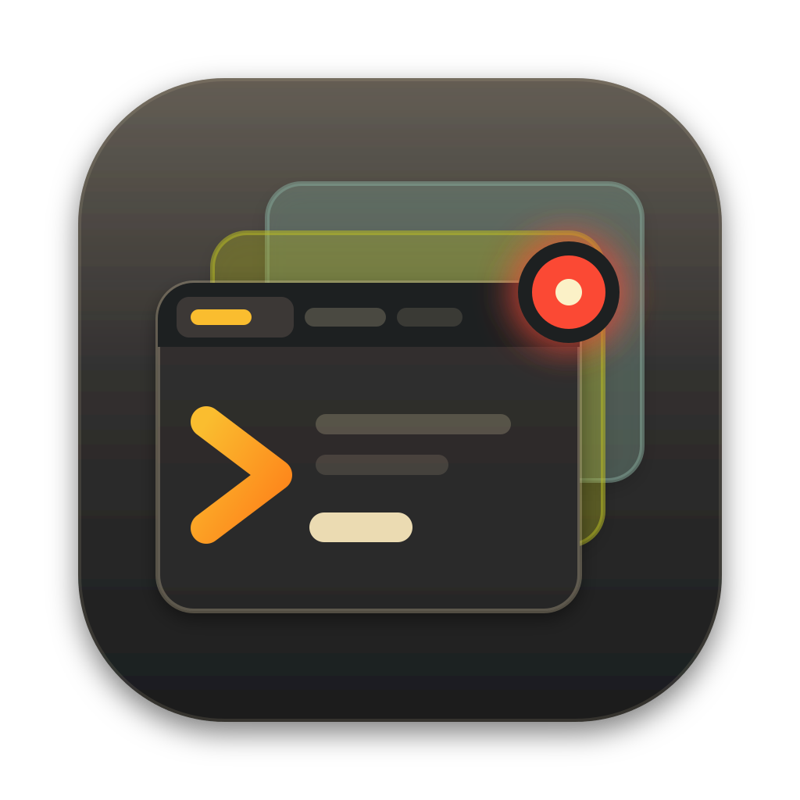

<p align="center">
  
</p>

<h1 align="center">WorkDesk</h1>

<p align="center">
  Every piece of work gets its own desk.<br>
  Built to manage <strong>hybrid AI development</strong> natively: you and your AI agents, on many tasks at once.
</p>

---

## Overview

With AI in the loop, writing code stopped being the slow part. What got slow is everything around it: several branches, pull requests and reviews open at once, a Claude working in some of them, and you keeping track.

WorkDesk is a macOS app that keeps **terminals, browser pages, your editor, branches, notes and Claude Code sessions together per task**, and tells you which desk needs you next.

- **Close the gap** between the work AI produces and what you can follow: one desk each, Signals say which needs you.
- **Work stateful:** terminals live in tmux, Claude sessions resume, tabs and notes are kept per desk.
- **Save resources:** park what waits, hibernate unused pages, see what each desk costs.
- **Orchestrate AI:** a Claude per desk, Signals from its hooks, skills, an experimental Orchestrator.
- **Several products** side by side with Profiles; **your data stays yours** in a git repo you own.

## Quick start

You need macOS (Apple Silicon), Node.js 22, [pnpm](https://pnpm.io) 11, `git`, `tmux` and VS Code with the `code` command.

```bash
pnpm install       # also rebuilds node-pty for Electron
pnpm dev           # run the app with hot reload
pnpm test          # unit and integration tests
pnpm package       # build an unsigned .dmg into dist/
```

`WORKDESK_SEED=1 pnpm dev` starts with in-memory demo data to look around.

## First-time setup

1. Allow VS Code control under *System Settings → Privacy & Security → Accessibility*.
2. Open the **Dashboard**: its checklist walks through the rest.
3. *Settings → Projects*: add a repository.
4. Sign in to GitHub (`gh auth login` or a token in *Settings → GitHub*).
5. *Settings → Claude*: install the hooks, so Claude's state becomes Signals.
6. Give the Status Repo (your Todos, notes and desks) a remote of your own as backup.

## Documentation

The docs are a [Docusaurus](https://docusaurus.io) site: the pages are in [`docs/`](docs/index.md), the site in `website/`.

| | |
|---|---|
| [Getting started](docs/getting-started.md) | requirements, install, first-time setup |
| [Use cases](docs/use-cases/index.md) | set up, configure, work in a desk, review, merge, profiles, browser, Claude, saving resources |
| [Features](docs/features/index.md) | the reference |
| [Developer guide](docs/developer-guide.md) | build, test, package, how it is built |
| [Decisions](docs/adr/index.md) | architecture decision records |

```bash
pnpm --dir website install   # once
pnpm docs:dev                                   # live preview at http://localhost:3000
pnpm docs:build                                 # production build, fails on a broken link
```

`.github/workflows/docs.yml` publishes it to GitHub Pages on every push to `main` (enable it once under *Settings → Pages → Source: GitHub Actions*).

Vocabulary (WorkDesk, Stage, Signal, Status Repo, …): [CONTEXT.md](CONTEXT.md). Open work: [ROADMAP.md](ROADMAP.md). Manual checks: [TESTING.md](TESTING.md).

## Contributing

Changes are welcome: see [CONTRIBUTING.md](CONTRIBUTING.md).

## License

[PolyForm Shield 1.0.0](LICENSE): the source is available and free to use, also at work, and you can change it and send changes back. What it does not allow is providing a product that competes with WorkDesk, for example selling it or a fork of it. This is *source-available*, not open source in the OSI sense. A fork needs its own name: the name *WorkDesk* is not part of the license.
