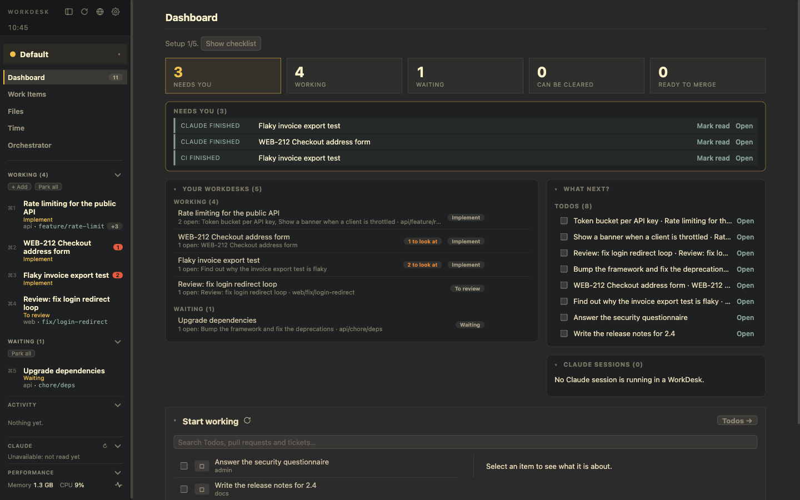

# Dashboard and time

## The Dashboard

The Dashboard answers one question: what next? From top to bottom:

- **Getting started** checklist (until you hide it): tools, Projects, GitHub, Notion, Claude hooks. Each step links to its Settings page.
- **Five numbers:** *Needs you*, *Working*, *Waiting*, *Can be cleared*, *Ready to merge*.
- **Needs you:** one list of everything that wants you, a colour per kind:

  | Colour | Kind |
  |---|---|
  | yellow | an open Signal that asks something: Claude waits, new review comments, a re-review request |
  | orange | an overdue Todo |
  | green | a pull request that is ready to merge |
  | blue | news: checks finished, a postponed WorkDesk is back |
  | purple | a WorkDesk that can be cleared |

  A click opens the WorkDesk. The row has *Mark read*, *Open on GitHub* or *Clear…*.
- **Your WorkDesks** by section, and **What next?**: open Todos (due ones first, overdue marked) with tick and snooze, and postponed WorkDesks with when they come back.
- **Claude sessions:** every Claude running in a WorkDesk, with its Account, state and last message. See [Claude](./claude.md).
- **Start working:** Todos, pull requests and tickets in one list. See [Work items](./work-items.md).

The count on the *Dashboard* entry of the left panel is the number of items in *What next?* (open Signals, open Todos and postponed WorkDesks).

## Refresh everything

The reload icon in the left panel's header runs the five-minute background round at once: the pull requests of the branches become work items, their state is read, and reviews are followed (re-review requests, comments, checks, merges). The icon turns while anything loads. **Hover it** to see what is loading and for how many seconds, so a long spinner tells you which step is slow.

## Activity

*Activity* at the bottom of the left panel lists the newest events of all WorkDesks: Stage changes, branches, pull request updates, Signals and Todos, each with the WorkDesk it happened in. A click opens that WorkDesk.

## Time

WorkDesk counts the time you spend in a WorkDesk, passively.

- **Counted:** only the WorkDesk on screen, only while you used keyboard or mouse in the last five minutes. Another window in front, such as a terminal or Slack, does not stop it. A locked screen or a gap of more than 90 seconds (sleep) is not counted.
- **Browser pages count for the WorkDesk that has them:** a page attached to it, a pull request or ticket among its work items, or a pull request it reviews, including sub-pages such as `/pull/806/files`. Any other page of the Browser, the Dashboard, Work Items and Files belong to no WorkDesk.
- **VS Code counts too:** while a VS Code window is in front, its WorkDesk (the `.code-workspace` or any of its branch folders) gets the time, even when the app shows another page. This is checked every five seconds and works on macOS only.
- **When it pauses:** after five minutes without input a small silent notification says so, once per stretch.

The **Time** page shows a week: a bar per day and a table of time per WorkDesk and day with totals, week by week with ◀ ▶. A WorkDesk's Details page has the same numbers (today, 7 days, a bar per day), and the Dashboard shows *Time today*.

Time is kept **locally** in the app's data folder (`time-tracking.json`, 90 days), not in the Status Repo: it changes every few seconds and would fill the repository with commits.

## Capture a Todo from anywhere

`⌥⌘T` is a global shortcut that works while another app has the focus. It brings WorkDesk up and asks for a title. The Todo goes into the WorkDesk you are in, or into your Todos when you are on another page. If another app already owns the shortcut, it is logged and *Capture a Todo…* in ⌘P still works.
