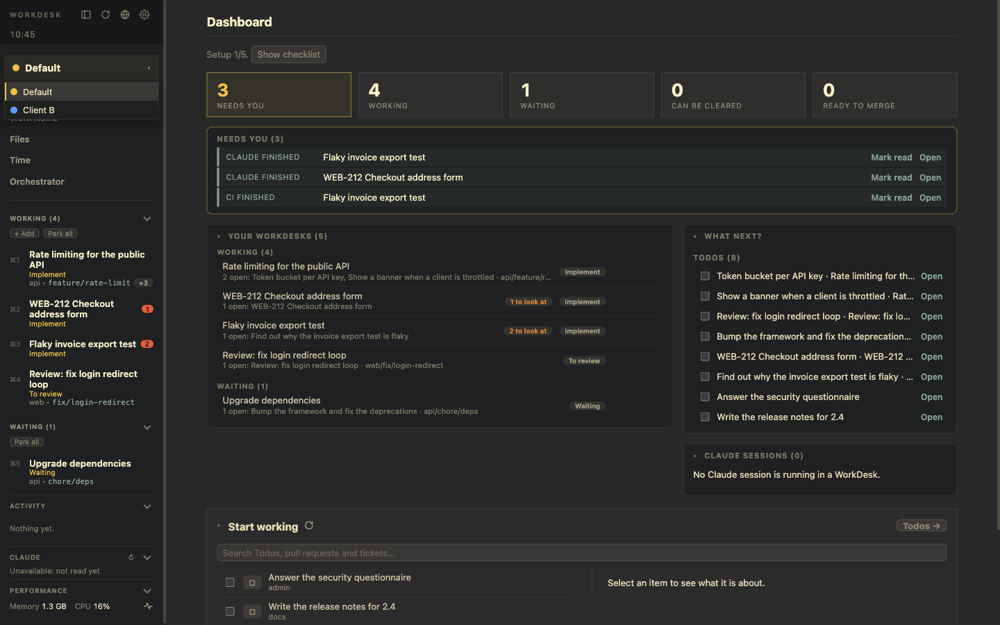

# Profiles

A **Profile** bundles what belongs to one product or client: a name and colour, the Status Repo its Todos and WorkDesks are kept in, its logins (GitHub, Notion, GitLab, Jira), its default Claude Account and its Projects.

There is always the **Default** Profile (#1). Everything without a Profile tag belongs to it.

## The selector

The **Profile selector** at the top of the left panel shows the Profile in view (colour dot and name). Its list has the Profiles. There is **always exactly one** in view.

It filters the left panel, the Dashboard (What next?, Claude sessions, Activity, Time today), Work Items, the Files page, the command palette, *Jump to…* and *Search all WorkDesks*. A small yellow count on it is the number of open Signals in the Profiles that are not in view.

## What is per Profile

| Per Profile | Shared by all |
|---|---|
| Todos, WorkDesks, repeating WorkDesks, Projects (tagged with the Profile in view; a WorkDesk started from a Todo takes the Todo's Profile) | The browser (history, favorites, sessions) |
| Credentials: GitHub, GitLab, Jira, Notion (Keychain items named by Profile), and their *skipped* lists | The `gh` login |
| Notion's database, the GitLab and Jira addresses, the Git hosts mapping | The `.env` store |
| The default Claude Account (used by WorkDesks that have none of their own) | The Claude hook folders |
| The Status Repo, and with it the **Files** page: knowledge, notes and scratch | Repeating WorkDesks' templates, favorites, Claude folders and sessions settings (in the first Status Repo) |

The background pull request watch reads each WorkDesk's pull requests with the login of the WorkDesk's **own** Profile, whichever Profile is in view. The pull request lists and the Dashboard offer only the repositories that are Projects of the Profile in view once there is more than one Profile.

## Status Repos

Each Profile writes its new Todos, WorkDesks, notes and events to the Status Repo you choose for it in *Settings → Profiles → Details*. The repos are listed and added (+) on *Settings → Status Repos*: the same one for several Profiles (each sees only its own Todos and WorkDesks, but the Files page then shows the same folders, since notes and knowledge are plain folders), or one each. Add a repo by pointing to a folder (made and `git init`ed when new) or by cloning a remote.

**Every registered repo is loaded and live at once**, so reminders, repeating WorkDesks, Signals, the pull request watch and time tracking keep working for all Profiles, in view or not. The selector only changes what you see. Pointing a Profile at another repo moves nothing: what exists stays in the repo it is in and stays visible. The first repo (`workdesk-status`) also holds what all Profiles share.

## Add and remove

- **Add:** *Settings → Profiles → +*, a name and a Status Repo. A colour is chosen for you; change it in the Profile's details.
- **Remove** asks first: its Todos, WorkDesks and Projects move to the Default Profile, its tokens are deleted from the Keychain, and its Status Repo stays registered and untouched.

See the walkthrough [Several products with Profiles](../use-cases/multiple-profiles.md).
