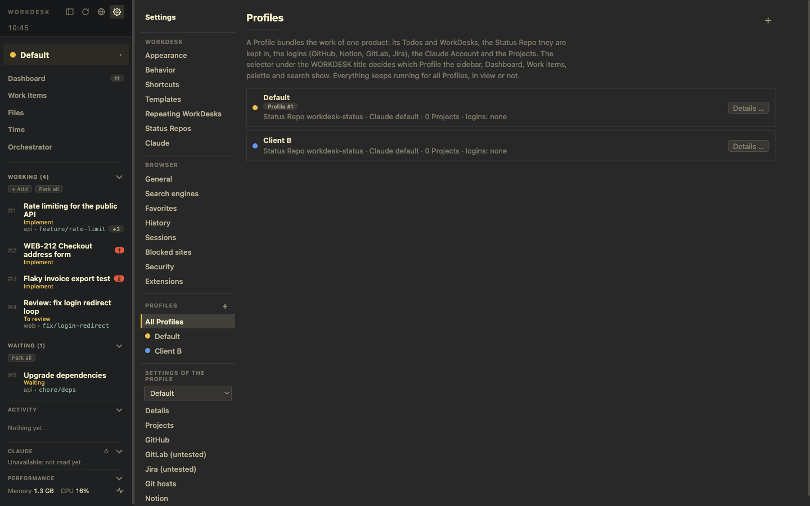

# Settings

The cog in the left panel's header opens *Settings*. The navigation lists, in order:

1. **What does not depend on a Profile:** *Appearance* (theme, tabs), *Behavior* (quitting, waiting), *Shortcuts*, *Templates*, *Repeating WorkDesks*, *Status Repos*, *Claude* (Accounts, usage, hooks, skills) and the **Browser** pages (General, Search engines, Favorites, History, Sessions, Blocked sites, Security, Extensions).
2. **Profiles:** a **+** in its header adds one; *All Profiles* is the list, and each Profile is an entry that opens its details.
3. **Settings of the Profile:** a selector for the Profile in view, and the pages that belong to it: *Details* (name, colour, Status Repo, Claude Account, logins, Projects, remove), *Projects*, *GitHub*, *GitLab*, *Jira*, *Git hosts* and *Notion*.

**Everything you add is added with the + button at the top of its page, in a dialog:** a Profile, Project, Status Repo, Claude Account, extension, browser session, repeating WorkDesk, Todo, branch, watched repository. The connection pages (GitLab, Jira, GitHub token, Notion client, backup remote) open their fields in a dialog too. The Dashboard's checklist and the usage meter link straight to the right page.

## Behaviour settings

| Setting | Where | Choices |
|---|---|---|
| When quitting | *Behavior* or the *WorkDesk* menu | *Ask*, *Keep running*, *Stop terminals* |
| When a WorkDesk starts waiting | *Behavior* | *Ask me*, *Park it* (asks anyway when something like a dev server or Claude runs), *Keep it active* |
| Hibernate unused pages | *Browser → General* | delay, off, and hosts that never hibernate |
| Default browser | *Browser → General* | make WorkDesk open links from other apps |
| Tracker and ad blocking | *Browser → Security* | none, trackers, trackers and ads; a site's own level is set in its site settings |
| Browsing history | *Browser → Security*, *History* | off, clear, forget pages older than N days |

Each page is described where its feature is: [Browser](./browser.md), [Services](./services.md), [Claude](./claude.md), [Profiles](./profiles.md), [Signals, parking and resources](./signals-and-resources.md).
