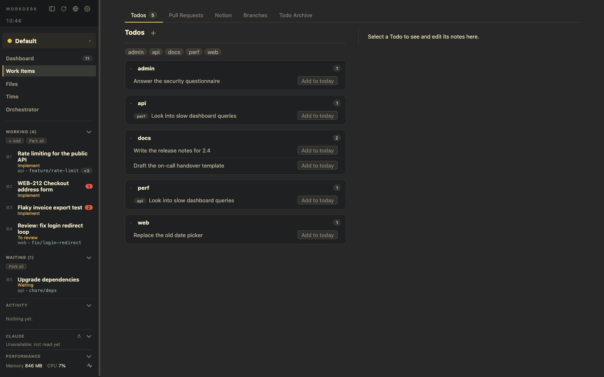

# Todos

Todos are the free-form part of your work: things you write yourself. A Todo lives on the *Todos* tab of **Work Items** until you put it into a WorkDesk, and then in that WorkDesk's checklist.

Pull requests and tickets are **never** turned into Todos: they are work items of their own. See [Work items](./work-items.md).

## Todos on the Work Items page

- **Add** with the **+** next to the title. Todos are grouped by **topic**, free tags you add yourself. Drag Todos to reorder.
- **Details:** click a Todo for its title, topics, link, a **markdown notes** field (autosaved, with preview), *Resolve* and *Delete*.
- **There is no Today or Backlog list.** **Add to today** makes a *planned* WorkDesk of a Todo, and the left panel is your day.
- **Resolved Todos** stay on the page, struck through, for the rest of the day. The next day they go into the **archive** (`archive/todos.json` of the Status Repo; the notes stay in `notes/`), and **Clear done** does that right away. The **Todo Archive** tab searches it, and **Restore** puts a Todo back, open. A Todo in a WorkDesk is never archived: it stays there as the record of what was done.

## The checklist of a WorkDesk

The top of a WorkDesk's Details page has its Todos as a checklist.

- Type a title and press Enter to add one. Tick to resolve. Drag a row (or use the arrows) to reorder.
- **due** sets a due time. **✕** takes the Todo out of the WorkDesk and deletes it, after an inline *Delete / Keep* question.
- Click a title for the Todo's details on the right.
- A folded **Note** on the Details page is a markdown scratch note for the whole WorkDesk (autosaved, `notes/desk-<desk>.md` in the Status Repo). It starts open when it has text. Clearing the WorkDesk archives it as `desk-note.md`.

## Due dates and reminders

- A Todo with a due time raises a **Signal** (*Todo due: title*) in its WorkDesk when the time comes. Checked every 30 seconds, once per due time.
- A Todo in no WorkDesk gets a system notification instead; a click opens the Dashboard, where *What next?* is.
- **Snooze** (1, 2, 4, 6 hours or tomorrow) sets a new reminder time. The due time stays, so the Todo stays marked overdue.
- In the *due* editor a Todo can **repeat** every day, every weekday or every week (shown with ↻). Resolving it starts the next one in the same WorkDesk, due at the next such day at the same time of day (after now, so a late tick catches up). The resolved one stays as the record.

## Capture from anywhere

`⌥⌘T` (or *Capture a Todo…* in ⌘P) asks for a title from any app. See [Dashboard and time](./dashboard-and-time.md).
