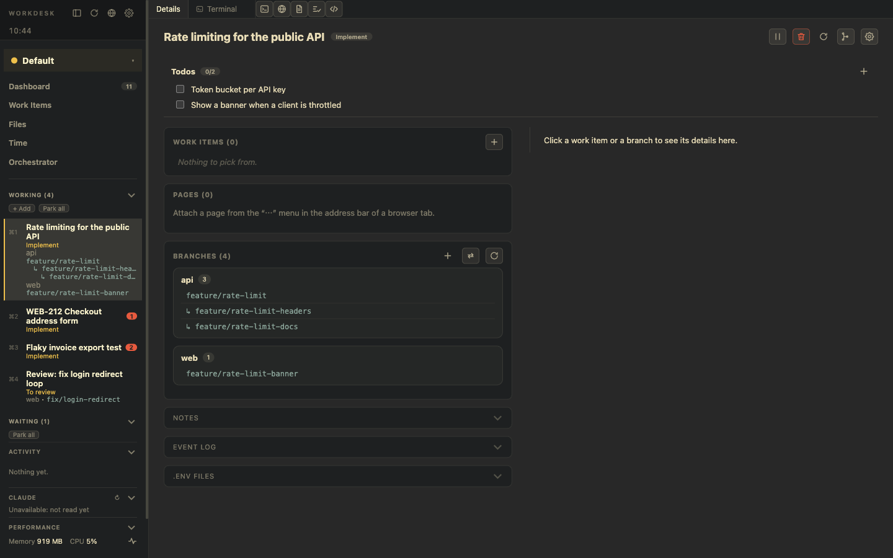
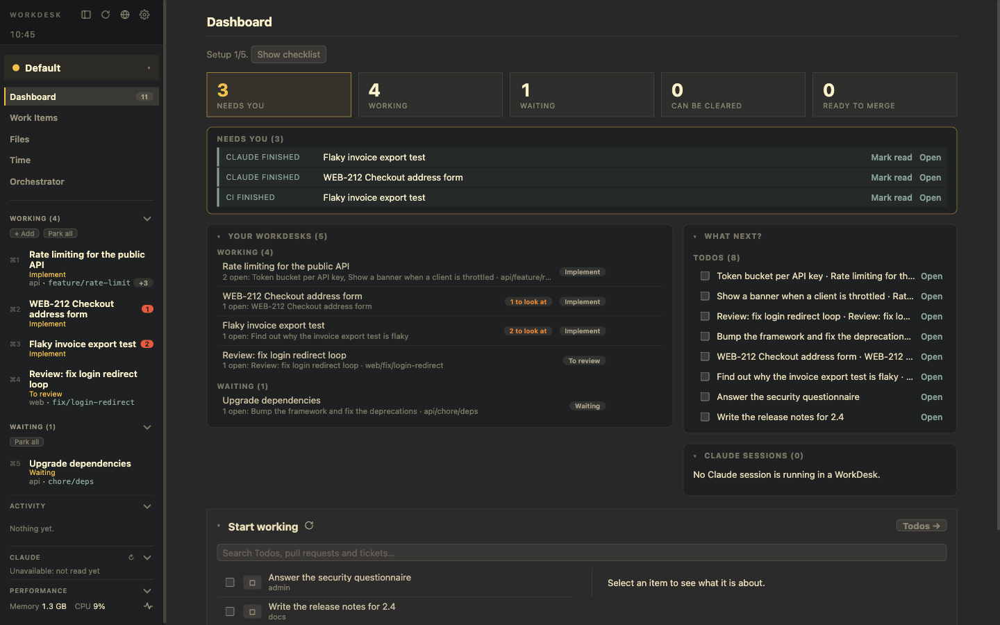

# WorkDesks

A **WorkDesk** is one piece of work: a review, a feature, a ticket, a chore. It has its own terminals, browser pages, editor window, branches, Todos and notes. You start it when you begin, park it when you wait, and clear it when you are done. Nothing from one task leaks into the next.

## Start a WorkDesk

Every WorkDesk has a name (the Todo's or the pull request's name is suggested). There are five ways to start one:

| From | How | What you get |
|---|---|---|
| Nothing | *+ Add* in the *Working* section | An empty WorkDesk: no Todos, no branches. Branches can be added later. |
| Todos | *Add to today*, then *Start* (or *Start together…* for several) | A WorkDesk with those Todos in its checklist. |
| A pull request | *Start review* on the Dashboard or the *Pull Requests* tab | A WorkDesk with the pull request as a work item; the branch is checked out or not, your choice. |
| A Notion ticket | *Start WorkDesk* in the ticket's details | You pick the Projects; each gets a branch named after the ticket key. |
| Branches | *From branches*: pick one or several, also across Projects | Branches that sit on top of each other become a [stack](./branches.md). |

**Add to today** makes a *planned* WorkDesk first: dimmed, with nothing running and nothing checked out. Planning asks GitHub nothing, so it is instant. **Start** opens it.

A WorkDesk has no type. A pull request that is not yours is a *reviewed pull request* of the WorkDesk. Its **Stage** follows GitHub (*To review → Reviewed, waiting → Re-review → Done*), worked out from all of its pull requests, and the one that needs you most wins.

## The Details tab

Details is always the first tab, and a new WorkDesk opens on it.

- **Title and buttons:** *Start* (planned WorkDesk) or *Park* / *Reactivate*, *Clear*, *Combine with…* and a cog for its settings (name, Stage, Claude Account).
- **Todos** as a checklist at the top: type a title and press Enter, tick to resolve, drag to reorder, set a due time.
- **Work items:** pull requests, tickets and Todos. The **+** adds a Todo, a pull request, a Notion ticket assigned to you or an existing branch. The open pull requests of the WorkDesk's branches become work items by themselves. Each pull request shows its state (`✓ 2 approved`, checks, *ready to merge*), also while the WorkDesk is parked.
- **Pages:** browser pages you attached as references.
- **Branches:** with their pull requests, unpushed and new commits, and the buttons Fetch, Pull and the `.env` actions. See [Branches](./branches.md).
- **Notes**, the **event log** (the last 20 things that happened: Stage changes, parking, branches, Todos, pull request updates, every Signal) and the **`.env` files** section are folded at the bottom.

Click a work item or a branch to see its details in the panel on the right.

## The left panel

From top to bottom:

- **Header:** the title and four icons (hide the panel, refresh everything, Browser, Settings), then the clock. Hover the clock for the date and the week of the year. Pinned browser tabs of the Browser page appear as small icons here.
- **Profile selector:** the Profile in view. See [Profiles](./profiles.md).
- **Pages of the Profile:** Dashboard, Work Items, Files, Time, Orchestrator.
- **WorkDesks,** in sections by what each is doing (below).
- **At the bottom:** Activity (the newest events of all WorkDesks), Claude usage, and Performance (memory and CPU; click to open the page).

### The sections

| Section | What is in it |
|---|---|
| **Working** | WorkDesks in use, in your own order. A red number is an open Signal. |
| **Waiting** | WorkDesks that wait for somebody else (Stage *Reviewed, waiting* or *Waiting*) and need nothing from you. |
| **Pull requests** | WorkDesks for pull requests of colleagues (one to review, none of yours), running or waiting alike, so they do not crowd your own work. The title opens *PRs in WorkDesks*: every pull request of a WorkDesk in a list, its GitHub page beside it, and *WorkDesk →* to go there. |
| **Can be cleared** | Everything they were about is done: pull requests merged or closed, Todos resolved. |
| **Planned** | Not started yet. |
| **Postponed** | Set aside until a time you chose. |

Rules worth knowing:

- **Parked is not a section.** A parked WorkDesk stays in the section it belongs to and says "parked" under its name.
- **A running WorkDesk with a Signal does not move.** The red number says it needs you. A parked one with a Signal goes on top of its section.
- **A Signal brings a waiting WorkDesk back to Working:** new review comments, finished checks, a re-review request. So does a Stage that no longer waits.
- **Parked WorkDesks are watched too.** The background round (every five minutes) still reads their pull requests, so an approval or a new comment raises a Signal and a notification. A merged or closed pull request makes a review *Done*.
- **Postpone:** right-click → *Postpone…* (1, 2, 4 or 6 hours, tomorrow 06:00, or a number of hours). It returns by itself when the time has come, or at once when a Signal needs you. *Bring back now* ends it early.
- **Park all** and **Reactivate all** are in each section and reach only the WorkDesks listed there, and only those of the Profile in view.
- `⌘1…⌘9` number the WorkDesks in the order of the sections.

### The right-click menu

*Start* / *Start again (wake it up)*, *Pause (park)*, *Bring back now*, *Postpone…*, *Mark as read* / *Mark as unread* (the latter gives a WorkDesk a red 1 until you open it), *Clear this WorkDesk…*, *Combine with another WorkDesk…* and *Save as template…*.

## Combine WorkDesks

If two WorkDesks turned out to be one piece of work: *Combine with…* (Details, ⌘P, the right-click menu, or `workdesk desk combine <other>`) takes another WorkDesk into this one. Its branch folders move with `git worktree move`, so uncommitted work and review comments come along. Its pull requests, Todos, attached pages, note and time are merged, and it is cleared. Its terminals close, and its tabs and Claude sessions are archived.

## Templates

Right-click a WorkDesk → *Save as template…*. A template keeps the Stage, the Todos that are still open and all Tabs with their Panes, including the pages and files they show. *Settings → Templates* lists the built-in templates (*Review PR*, *Release*, *Bug triage*) and yours. ⌘P → *New WorkDesk from template* starts one. *Settings → Repeating WorkDesks* plans a WorkDesk from a template every day, weekday or week.

## Park and clear

- **Park** shuts down terminals, dev servers and the editor window. Tabs, notes, branches, Todos and Claude sessions are kept and come back on *Reactivate*.
- **Clear** ends a WorkDesk for good and never happens by itself. A pre-flight check lists uncommitted, untracked and unpushed work, branches without a remote and `.env` files not in the store, and asks for approval. Notes, the final Stage and Claude session ids are archived, worktrees are removed, and **branches are never deleted**.

See [Signals, parking and resources](./signals-and-resources.md) for what quitting and restarting do.
