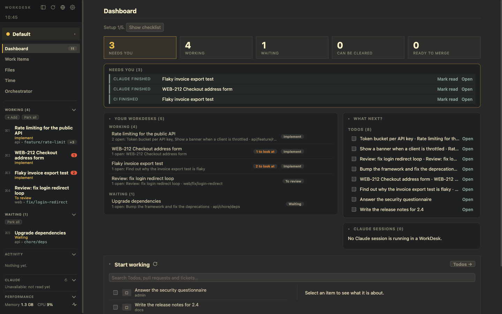

# WorkDesk

**Every piece of work gets its own desk.** Built to manage hybrid AI development natively: you and your AI agents, on many tasks at once.

[Get started](/getting-started) · [Use cases](/use-cases) · [Features](/features) · [Developer guide](/developer-guide)

## The problem

With AI in the loop, writing code stopped being the slow part. What got slow is everything around it: several branches, pull requests and reviews are open at the same moment, a Claude is working in some of them, and you are the one who has to keep track.

WorkDesk is a macOS app that keeps **terminals, browser pages, your editor, branches, notes and Claude Code sessions together per task**, and tells you which desk needs you next.

## What it gives you

- **Close the gap.** More branches and pull requests than you can follow: one desk each, and the left panel says which one needs you.
- **Work stateful.** Terminals live in tmux, Claude sessions resume, tabs, notes and layout are kept. Park a desk and come back tomorrow.
- **Save resources.** Park what waits, hibernate unused pages, see what each desk costs.
- **Orchestrate AI.** A Claude per desk with the Account you choose, Signals from its hooks, skills, and an experimental Orchestrator.
- **Hybrid, natively.** You and the AI share one worktree, terminal, browser, editor and review comments.
- **Your data stays yours.** Plain files in a git repo you own; tokens stay in the macOS Keychain.

## Where to go next

- [Getting started](/getting-started): requirements, install and the first-time setup.
- [Use cases](/use-cases): step by step, how to set up, configure, review, merge, run several products and use the browser.
- [Features](/features): the reference for everything the app does.
- [Developer guide](/developer-guide): build, test, package, how it is built.

## Status

WorkDesk is mainly built for one person's daily use and shared as source-available software under the [PolyForm Shield License 1.0.0](https://polyformproject.org/licenses/shield/1.0.0/): free to use, also at work, and open to contributions, but not to be sold or offered as a competing product. It runs on macOS (Apple Silicon build).
