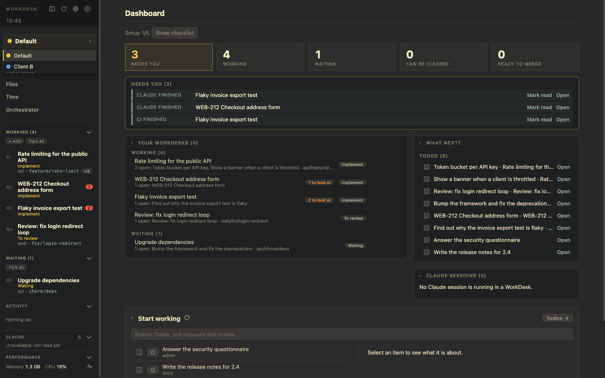

# Several products with Profiles

**Goal:** work on more than one product or client without their Projects, logins and Todos mixing.

A **Profile** bundles a name and colour, the Status Repo its Todos and WorkDesks are kept in, its logins (GitHub, Notion, GitLab, Jira), its default Claude Account and its Projects. There is always a **Default** Profile; everything that existed before Profiles belongs to it.

## Add a second Profile

1. *Settings → Profiles → +*, give it a name and a colour.
2. Under *Settings of the Profile*, pick it in the selector and fill in its pages: *Details* (Status Repo, Claude Account), *Projects*, *GitHub*, *Notion* and so on. Credentials are per Profile; the `gh` login is shared.
3. Pick its **Status Repo**: the same repo as another Profile (each Profile still sees only its own Todos and WorkDesks), or a repo of its own. Add repos under *Settings → Status Repos*, by pointing to a folder or cloning a remote.

## Switch

The **Profile selector** at the top of the left panel always has exactly one Profile in view. It filters the left panel, the Dashboard, Work Items, the command palette, *Jump to…* and *Search all WorkDesks*. A small count on it is the number of open Signals in the Profiles you are **not** looking at.

New Todos, WorkDesks and Projects are tagged with the Profile in view. A WorkDesk started from a Todo takes the Todo's Profile.

## What keeps running

Every registered Status Repo is loaded at once. Reminders, repeating WorkDesks, Signals, the pull request watch and time tracking keep working for all Profiles, in view or not. The selector only changes what you see.

**Park all** and **Reactivate all** in each section of the left panel only reach the WorkDesks of the Profile in view.

## Remove a Profile

Asks first: its Todos, WorkDesks and Projects move to the Default Profile, its tokens are deleted from the Keychain, its Status Repo stays registered and untouched.

## Not per Profile (yet)

The browser (history, favorites, sessions), the `.env` store and the Claude hook folders are shared.

## Related

[Profiles](/features/profiles) · [Data and storage](/features/data-and-storage)
