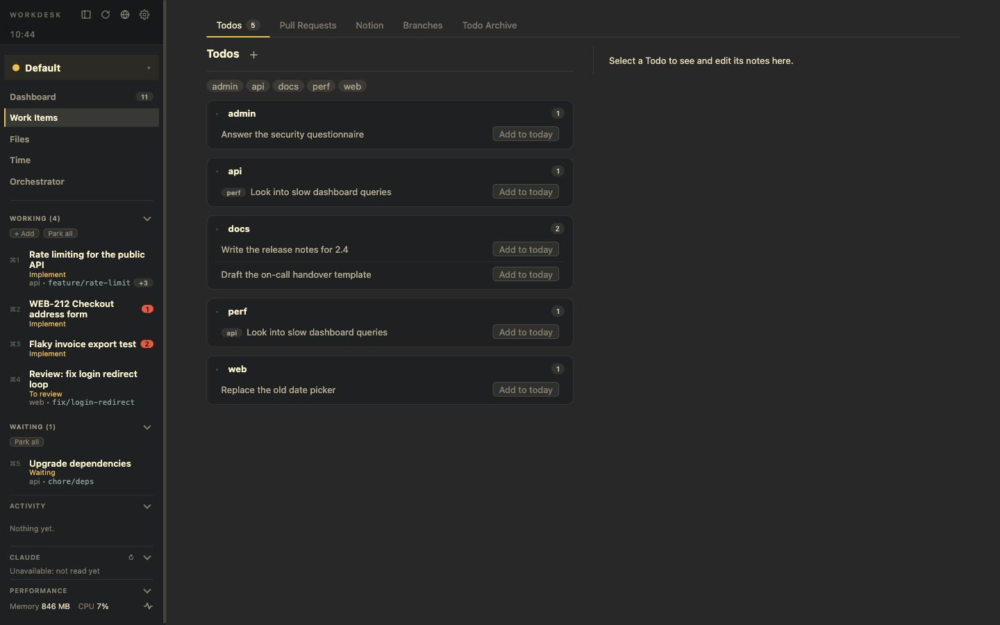

# Set up and start working

**Goal:** go from an empty app to a WorkDesk with a branch, a terminal and a browser.

## 1. Register a Project

A Project is a repository WorkDesk may check branches out of.

1. *Settings → Projects → +*.
2. Clone a repository (it is kept as a bare clone in `.projects/`), or point to a clone you already have. Its `.env` files are then taken into the central store.
3. Optional: add **setup commands**, one per line (for example `pnpm install`). Whenever a branch of this Project is checked out into a WorkDesk, a *Setup* terminal tab opens in the branch folder and types them in, so you watch them run.

## 2. Write a Todo

On *Work Items → Todos*, press the **+** next to the title, give it a title and topics. A Todo is free-form: notes (markdown), a due time, and a link.

## 3. Plan it, then start it

- **Add to today** makes a *planned* WorkDesk: dimmed in the left panel, nothing running, nothing checked out. Planning asks GitHub nothing, so it is instant.
- **Start** opens it. A WorkDesk can also be started from a pull request, a ticket, existing branches (*From branches*), or empty with *+ Add* in the *Working* section.

## 4. Add a branch

On the WorkDesk's *Details* tab, under Branches, type a branch name: an existing one is checked out, a new one is created (optionally on top of another branch, which makes a stack). It gets its own worktree inside the WorkDesk folder, so no checkout ever switches anything, and the Project's setup commands run.

## 5. Work

Open a terminal tab, a browser tab, or the Files and Review tabs from the new-tab buttons. See [Work in a WorkDesk](/use-cases/working-in-a-workdesk).

## Related

[Todos](/features/todos) · [Branches](/features/branches) · [WorkDesks](/features/workdesks)
