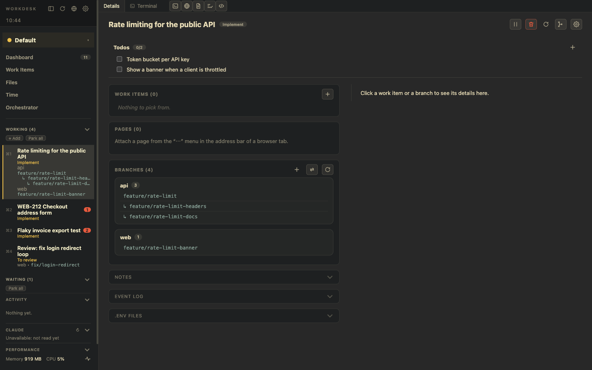

# Work in a WorkDesk

**Goal:** keep several pieces of work moving without losing track of any.

## Your day is the left panel

- **Working** lists the desks in use, **Waiting** those that wait for somebody else, **Planned** the ones you have not started, **Postponed** the ones that come back later, and **Can be cleared** the finished ones.
- A red number on a desk is an open **Signal**: Claude finished or needs input, a review came in, checks are done. Desks with a Signal come first.
- `⌘1…⌘9` switch desks; `⌘P` opens the command palette for everything else, including *Jump to…* and *Search all WorkDesks*.

## Inside one desk

1. **Details** is always the first tab: Todos as a checklist, branches and their pull requests, work items, notes, and an event log of what happened.
2. Add **terminal** tabs (in tmux, so they survive), **browser** tabs, and **Files** or **Review** tabs. Tabs hold panes you can split and drag.
3. Ask Claude Code to do work in a terminal; its Signals tell you when it needs you. `$WORKDESK_CLI` lets Claude open desks, add branches and tick Todos.
4. Open files in the light editor, or in your own VS Code window for the desk (one multi-root workspace per WorkDesk).
5. Read what changed in **Review mode**, add line comments, and let Claude read them back.

## When you wait

- Moving to a waiting Stage (for example after you reviewed a pull request) puts the desk under **Waiting**; WorkDesk can park it for you.
- **Postpone** a desk until a time you choose; it returns by itself, and at once if a new Signal arrives.
- **Park** shuts its terminals and editor down but keeps tabs, notes and Claude sessions. A parked desk is still watched, so an approval still reaches you.

## When you are done

**Clear** ends a desk for good: a pre-flight check lists uncommitted, untracked and unpushed work, notes and Claude session ids are archived, worktrees are removed, branches are never deleted.

## Related

[WorkDesks](/features/workdesks) · [Terminals](/features/terminals) · [Signals and resources](/features/signals-and-resources)
